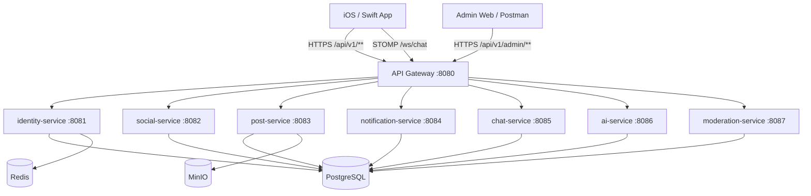

# Kiến trúc hệ thống

## 1. Sơ đồ tổng thể

Code hiện tại dùng Spring Cloud Gateway Server Web MVC. Trang Notion đề xuất WebFlux, nhưng không nên viết filter/config theo WebFlux nếu chưa chuyển dependency và runtime.

## 2. Ranh giới giao tiếp

### Public API

- Prefix: `/api/v1/**`.
- Client luôn gọi qua Gateway ở cổng `8080`.
- Endpoint riêng tư dùng `Authorization: Bearer <access-token>`.
- Endpoint admin dùng admin JWT có role `MODERATOR` hoặc `SUPER_ADMIN`.
- Gateway không expose `/internal/v1/**`.

### Internal API

- Prefix: `/internal/v1/**`.
- Service gọi trực tiếp service đích bằng base URL nội bộ.
- Header bắt buộc: `X-Internal-Api-Key`.
- Giao tiếp liên service hiện dùng REST đồng bộ.
- Không được cho mobile client biết hoặc sử dụng internal API key.

### WebSocket

- STOMP handshake endpoint: `/ws/chat`.
- CONNECT frame phải có `Authorization: Bearer <access-token>`.
- Client gửi message tới `/app/chat.send`.
- Client subscribe `/topic/conversations/{conversationId}`.
- Chat service kiểm tra user có thuộc conversation trước khi cho subscribe.

## 3. Route của Gateway

| Route | Service đích |
| --- | --- |
| `/api/v1/auth/**`, `/users/**`, `/terms/**`, `/account/**` | identity-service |
| `/api/v1/friends/**`, `/friend-requests/**`, `/blocks/**` | social-service |
| `/api/v1/media/**`, `/posts/**`, `/feed/**`, `/widget/**` | post-service |
| `/api/v1/device-tokens/**`, `/notifications/**` | notification-service |
| `/api/v1/conversations/**`, `/messages/**`, `/ws/chat/**` | chat-service |
| `/api/v1/ai/**` | ai-service |
| `/api/v1/reports/**`, `/admin/**` | moderation-service |

## 4. Ownership dữ liệu

PostgreSQL đang dùng chung cho MVP, nhưng quyền ghi tuân theo ownership:

| Service | Bảng sở hữu |
| --- | --- |
| identity-service | `users`, `terms_versions`, `user_terms_acceptance`, `account_deletion_requests` |
| social-service | `friend_requests`, `friendships`, `blocks` |
| post-service | `posts`, `saved_posts` |
| notification-service | `notifications`, `device_tokens` |
| chat-service | `conversations`, `messages` |
| ai-service | `ai_generations` |
| moderation-service | `reports`, `admins` |

Nguyên tắc:

- Chỉ owner được ghi vào bảng.
- Service khác lấy hoặc thay đổi dữ liệu qua internal API.
- Không tạo join xuyên ownership trong business code.
- Thay đổi schema đi qua Flyway; JPA chạy `validate`.
- OTP và refresh-token session nằm trong Redis, không nằm trong PostgreSQL.
- Media nằm trong MinIO/object storage; bảng chỉ giữ metadata và URL.

## 5. Security và observability hiện tại

- Gateway và từng service đều xác thực JWT.
- Internal endpoint được bảo vệ bằng `X-Internal-Api-Key`.
- `X-Request-Id` được tạo nếu request chưa có, trả lại trong response và đưa vào MDC log.
- Lỗi API dùng RFC 9457 `ProblemDetail` với `title`, `detail`, `code`, `requestId` và `fieldErrors` khi validate thất bại.
- Health endpoint: `/actuator/health`.
- OpenAPI từng service: `/v3/api-docs`; Swagger UI: `/swagger-ui.html`.

## 6. Hạ tầng local

| Thành phần | Cổng |
| --- | ---: |
| Gateway | 8080 |
| Identity | 8081 |
| Social | 8082 |
| Post | 8083 |
| Notification | 8084 |
| Chat | 8085 |
| AI | 8086 |
| Moderation | 8087 |
| PostgreSQL | 5432 |
| Redis | 6379 |
| MinIO API / Console | 9000 / 9001 |

Các secret mặc định chỉ phù hợp local. Production phải thay JWT secret, internal API key, DB/MinIO/admin credential và tắt việc trả OTP trong response.
