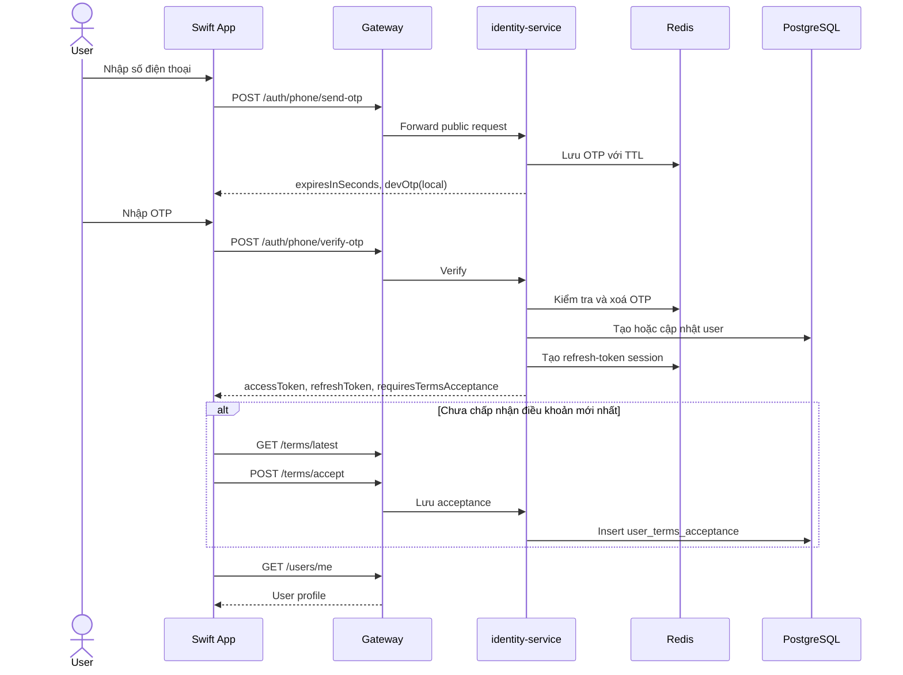
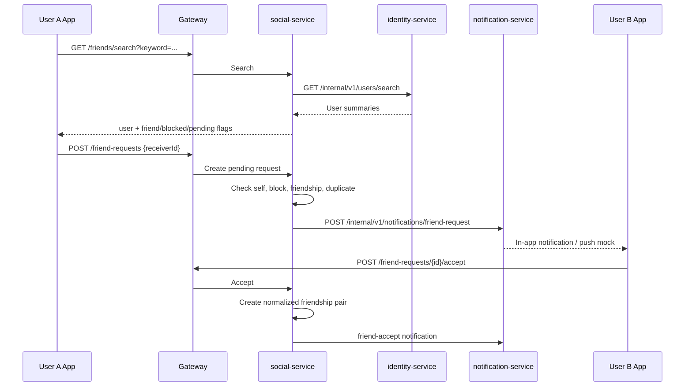
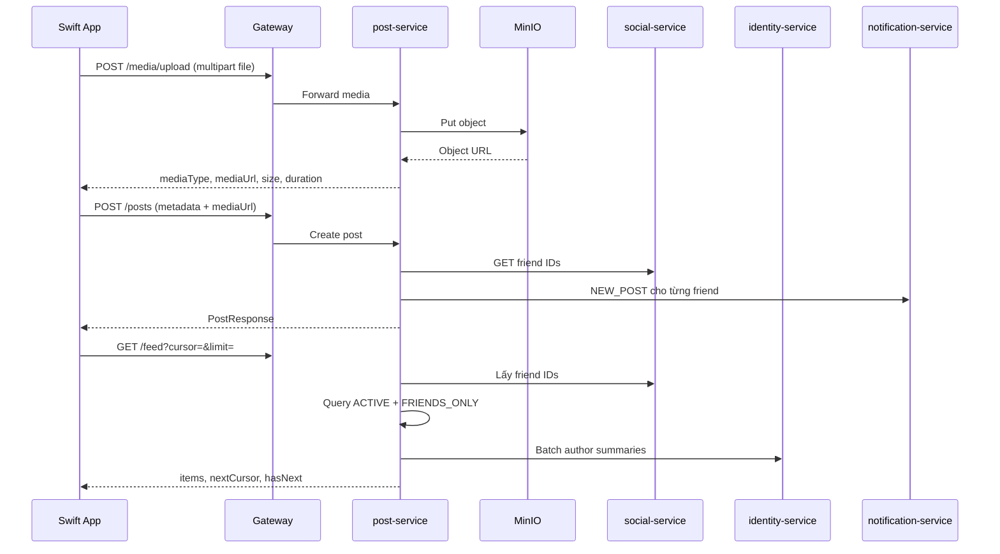
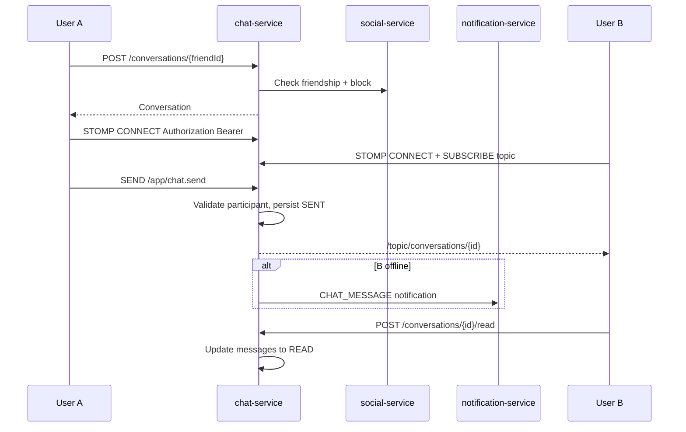
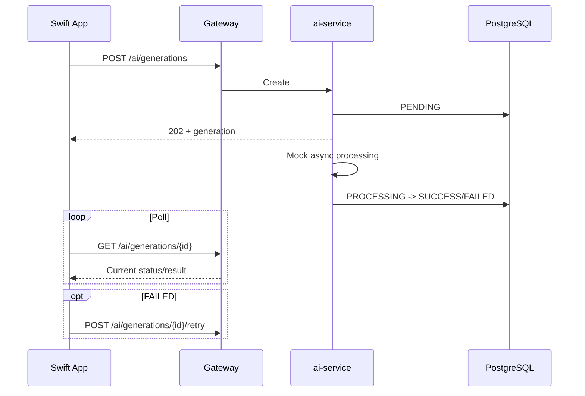
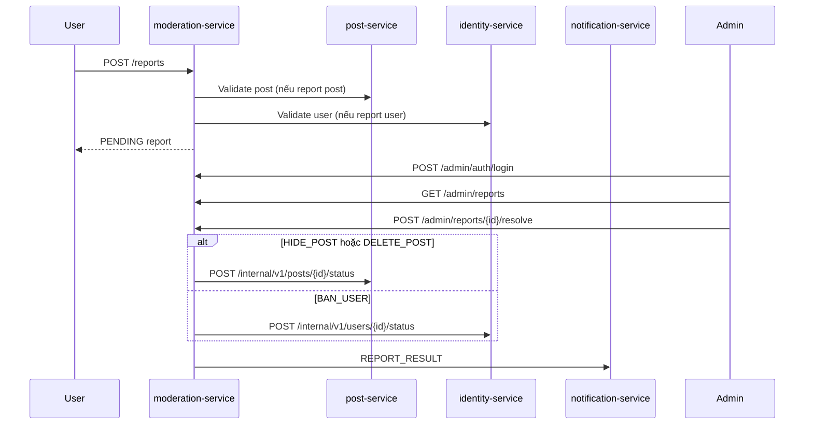

# Luồng hoạt động

## 1. Đăng nhập bằng số điện thoại và chấp nhận điều khoản

Áp dụng UC-01, UC-02, UC-18.

Ngoại lệ chính:

- OTP sai/hết hạn: `INVALID_OTP` hoặc `OTP_EXPIRED`.
- Phone/OTP sai format: `VALIDATION_FAILED`.
- Terms version cũ: `TERMS_VERSION_OUTDATED`.
- Production phải rate-limit theo IP, phone và device; adapter SMS hiện vẫn là mock/local.

Google login gọi `POST /auth/google` với `idToken`, sau đó dùng chung nhánh tạo user, cấp token và kiểm tra terms.

## 2. Tìm bạn, gửi và xử lý lời mời

Áp dụng UC-03, UC-04.

Decline đổi request sang `DECLINED`. Block sẽ xoá friendship hiện có, đóng pending request hai chiều và ngăn feed/chat/lời mời.

Deep-link mời bạn có trong use case Notion nhưng backend chưa có API phát hành/resolve invite link; xem [khoảng trống](05-gaps-and-roadmap.md).

## 3. Upload media, tạo post, feed và widget

Áp dụng UC-05, UC-06, UC-08 đến UC-12, UC-20.

Quy tắc:

- `IMAGE`: JPEG/PNG tối đa 10 MB.
- `GIF`: tối đa 20 MB và `durationSeconds <= 5`.
- Visibility mặc định do service xử lý; feed chỉ trả nội dung user được quyền xem và không bị block.
- Filter ảnh và lưu vào Photos là client-side; backend chỉ lưu `filterApplied` và cung cấp media URL.
- Widget gọi `GET /widget/latest-post` để lấy payload nhỏ gọn.

Hiện file upload đi xuyên qua Gateway. Thiết kế production nên chuyển sang presigned URL để mobile upload trực tiếp object storage.

## 4. Chat realtime và trạng thái đọc

Áp dụng UC-13.

Code có enum `SENT`, `DELIVERED`, `READ`, nhưng luồng cập nhật `DELIVERED` riêng chưa được expose thành API/receipt. Đây là chức năng cần bổ sung nếu UI phải hiển thị chính xác ba trạng thái.

## 5. Notification

Áp dụng UC-19.

Trigger hiện có:

- `FRIEND_REQUEST`
- `FRIEND_ACCEPT`
- `NEW_POST`
- `CHAT_MESSAGE`
- `REPORT_RESULT`

Service nguồn gọi `/internal/v1/notifications/{type}`. Notification service lưu record, dùng `Idempotency-Key` nếu caller cung cấp, sau đó adapter push hiện chỉ log mock. Mobile lấy danh sách bằng cursor, mark một notification hoặc toàn bộ là đã đọc.

## 6. AI generation

Áp dụng UC-07.

Provider AI và job queue production chưa được tích hợp. Nếu AI lỗi, client vẫn có thể dùng ảnh gốc để tạo post.

## 7. Report và moderation

Áp dụng UC-14, UC-15.

`WARN_USER` hiện đóng report nhưng chưa có kênh cảnh báo riêng ngoài kết quả report. Audit log từng thao tác moderation cũng chưa có trong MVP.

## 8. Xoá tài khoản

Áp dụng UC-17.

1. User gọi `POST /account/delete-request`.
2. Identity service từ chối nếu đã có request `PENDING`.
3. User chuyển sang `INACTIVE`.
4. Tạo lịch purge sau 30 ngày.
5. Xoá refresh-token sessions trong Redis.

Worker hard-delete, API huỷ yêu cầu trong thời gian ân hạn và trạng thái purge thực tế chưa có.
