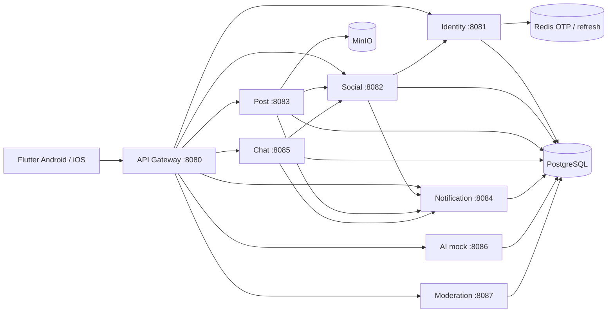

# LocCoc MVP Architecture and Bounded Contexts

Tài liệu thiết kế kiến trúc theo thẻ Trello **`LC-S0-02`** — Chốt MVP và kiến trúc triển khai cho nhóm ba người.

## 1. Quyết định kiến trúc chính (ADR)

1. **Monorepo**: Cấu trúc gồm `backend/` (Maven multi-module) và `loccoc_application/` (Flutter mobile app).
2. **Giao tiếp liên dịch vụ**: Giao tiếp nội bộ sử dụng REST đồng bộ với Header `X-Internal-Api-Key`. Không dùng Kafka/RabbitMQ trong MVP để giảm thiểu độ phức tạp vận hành.
3. **Cơ sở dữ liệu**: MVP dùng một cụm PostgreSQL và schema `public` dùng chung, nhưng migration/grant vẫn phân định bảng theo service owner. Thiết kế đích hậu MVP dùng schema riêng theo service. Ownership hiện tại:
   - `identity_service`: `users`, `terms_versions`, `user_terms_acceptance`, `account_deletion_requests`
   - `social_service`: `friend_requests`, `friendships`, `blocks`
   - `post_service`: `posts`, `saved_posts`, `media`
   - `notification_service`: `notifications`, `device_tokens`
   - `chat_service`: `conversations`, `messages`
   - `ai_service`: `ai_generations`
   - `moderation_service`: `reports`, `admins`
4. **Bộ nhớ đệm & Realtime**:
   - Redis: Quản lý OTP mock, blacklist token / refresh token session, presence tạm thời.
   - WebSocket (STOMP): Nhắn tin realtime trong `chat-service`.
5. **Object Storage**: MinIO (S3-compatible) cho hình ảnh và media.
6. **Bảo mật**:
   - Gateway (cổng 8080) là điểm tiếp nhận duy nhất cho Mobile client.
   - JWT Access Token (HS256) chứa thông tin định danh và quyền.
   - Endpoint nội bộ `/internal/**` chặn từ Gateway, chỉ cho phép giao tiếp giữa các container với internal key.

## 2. Danh mục ngoài phạm vi MVP (Deferred / Icebox)

- Khám phá cộng đồng, Public Feed, Recommendation AI phức tạp.
- Group chat, cuộc gọi thoại / video.
- Home screen widget và GIF động nặng.
- Tích hợp SMS OTP nhà mạng thật (dùng OTP mock trong MVP).
- Tích hợp AI provider trả phí (dùng Fake AI Generator Worker).
- Service Mesh (Istio), Kubernetes, Kafka.

## 2.1 Trạng thái close-out Sprint 0–1 (21/10/2026)

Các câu dưới đây là contract trạng thái chung với README, báo cáo follow-up và
backend roadmap:

- MVP chấp nhận schema `public` dùng chung với ownership/grants.
- Schema riêng theo service được hoãn sang sprint hậu MVP.
- Mock/demo không production-ready.
- Adapter production AI, payment, email và push được hoãn sang Icebox.

Quyết định này giữ migration, backup/restore và môi trường local đủ đơn giản cho
nhóm ba người, trong khi ownership bảng vẫn được kiểm soát bằng grant và ranh
giới repository. Trước production, nhóm phải lập migration riêng cho từng
schema, cấu hình `search_path`/credential theo service, diễn tập rollback và
backup/restore, rồi thay các mock bằng adapter có secret management, retry,
idempotency, metrics và quota/cost control. Quyết định hoãn không phải bằng
chứng nghiệm thu cho hai hạng mục Trello đó.

## 3. Context và dependency hiện tại

Sáu bounded context trong kế hoạch không đồng nghĩa sáu process hiện tại:
User được triển khai bằng Identity + Social; AI hiện tách khỏi Post;
Admin tương ứng Moderation; Subscription chưa triển khai. Đây là hiện trạng
để nhóm review, chưa phải xác nhận chấp thuận thay đổi scope/schema.
